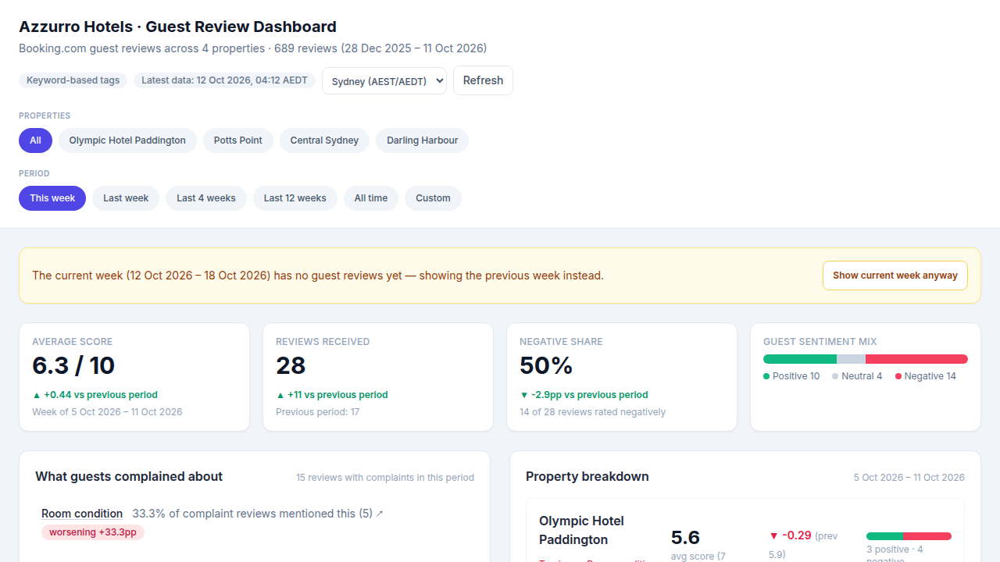
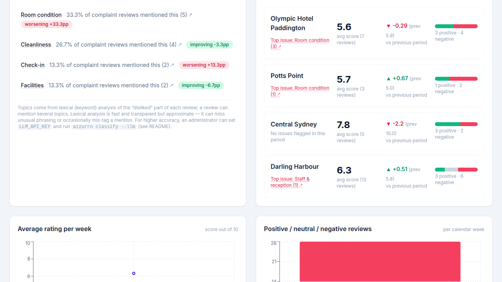
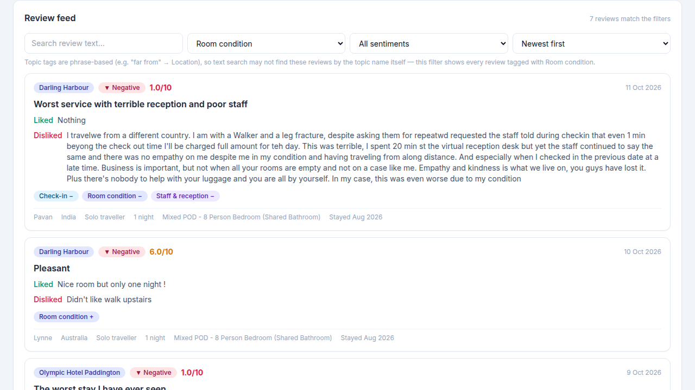
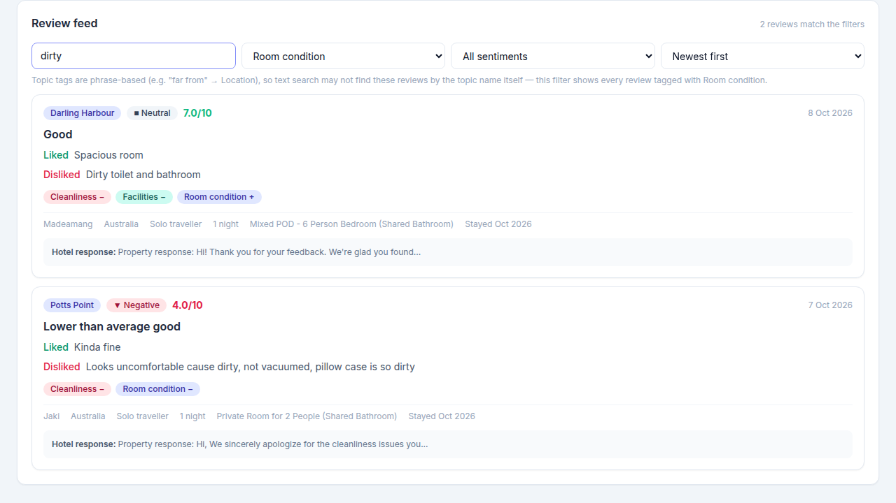
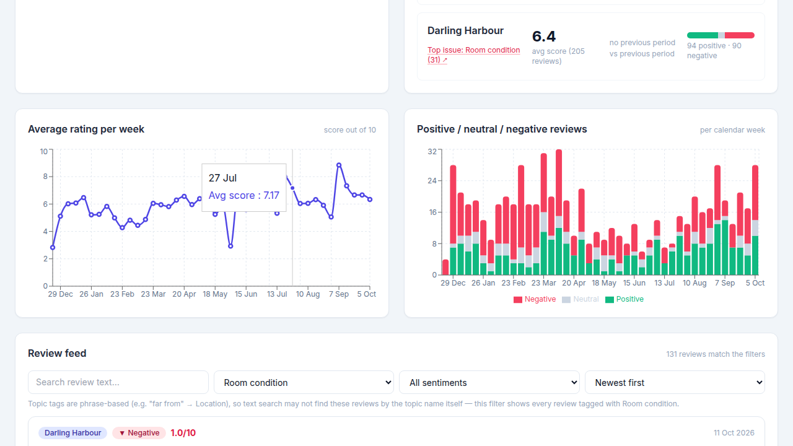
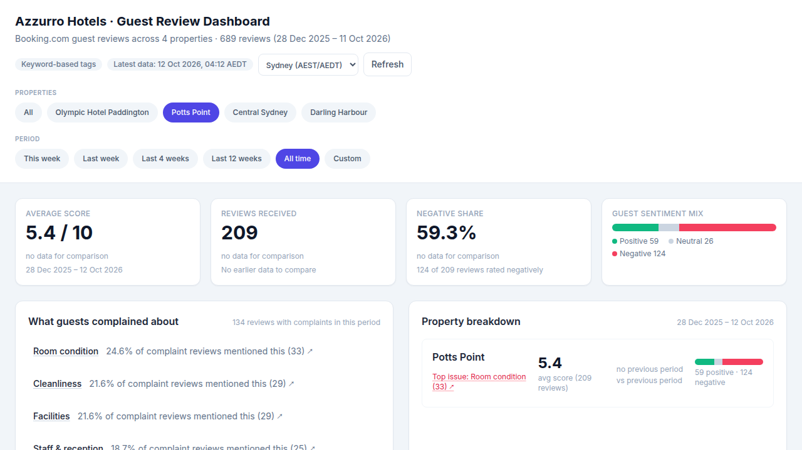
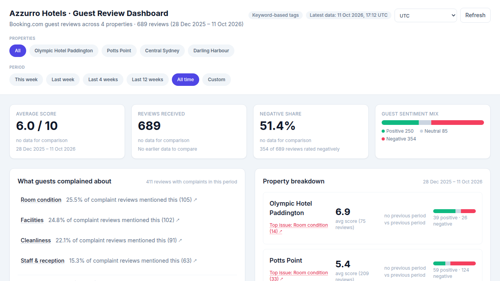

# Tutorial — A Guided Tour

A 5-minute read (or 50-second watch) that walks through everything the
dashboard can do.

**Can't run it locally?** The same dashboard is hosted as a read-only demo:
**https://palash018.github.io/review-dashboard/** (data frozen at the last
export — run locally for live data).

---

## Video walkthrough (50 s)

https://github.com/palash018/review-dashboard/assets/demo-tour.mp4

<video src="demo-tour.mp4" controls muted playsinline width="100%"></video>

*(If the embedded player doesn't render above, open
[`docs/demo-tour.mp4`](docs/demo-tour.mp4) directly.)*

The video shows, in order: the KPI cards, complaint insights, clicking a
complaint to jump to matching reviews, the keyword tooltip, text search,
trend charts, single-property filtering and the timezone switch.

---

## Step 1 — The week at a glance

Open the dashboard. The four cards at the top answer the morning questions:
how guests scored us, how many reviewed us, what share were unhappy, and the
mix of positive / neutral / negative reviews — each compared to the previous
period (green = better, red = worse).



> **Monday morning tip:** a brand-new week starts empty, so the dashboard
> automatically shows last week with a yellow notice instead of a blank
> screen. Press *"Show current week anyway"* to see the fresh (empty) week.

## Step 2 — What guests complained about

Below the cards, the complaints list ranks the operational issues guests
actually wrote about, with the trend versus the previous period.
The property breakdown next to it shows each hotel's score and its **top
issue**.



## Step 3 — From number to actual reviews

Every complaint line and every "Top issue" is a link. Click one — the page
jumps straight to the review feed, pre-filtered to that topic.



## Step 4 — Why was a review tagged?

Hover any coloured topic chip on a review (desktop). It shows the exact
words that triggered the tag, so classifications are never a black box.


## Step 5 — Find specific feedback

Type any word in the search box — try "dirty", "noise" or "staff" — or use
the dropdowns to filter by topic or sentiment. Sort by *Lowest rated* to see
the worst experiences first.



## Step 6 — Zoom out with trends

Switch the period to *Last 4 weeks* / *Last 12 weeks* / *All time* in the top
bar. The charts redraw: weekly average score and the volume of positive vs
negative reviews over time.



## Step 7 — Focus on one hotel

Tap a property chip (e.g. *Potts Point*) — every number, chart and review
now belongs to that hotel only. Tap *All* to go back.



## Step 8 — Timezone

The clock selector (top right) switches Sydney / IST / UTC. It changes how
timestamps are displayed and which day counts as "today" for week
boundaries — useful when the Sydney week has already rolled over but UTC
hasn't.



---

## Keeping data fresh

The dashboard shows everything collected so far. To pull the newest reviews
from Booking.com (about a minute):

```bash
make update    # then make demo
```

See [QUICKSTART.md](QUICKSTART.md) for setup and [USER_GUIDE.md](USER_GUIDE.md)
for the plain-language reference.
